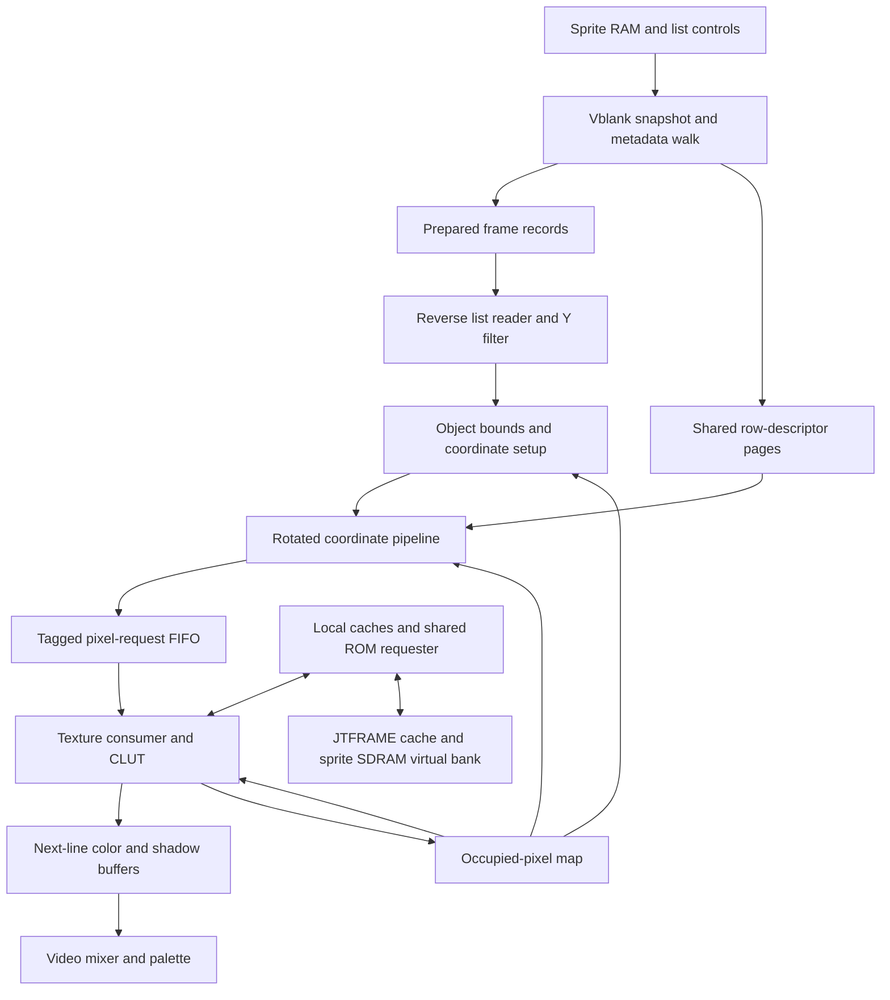

# Apache 3 sprite rendering

Apache 3 draws variable-width runs of 8×8 tiles, with scaling, flips,
rotation and optional horizontal repetition. The FPGA renderer prepares a
snapshot during vertical blanking, then builds the next sprite scanline while
the current one is displayed. It traverses objects from front to back so that
an occupied destination pixel can stop work on objects behind it.

The behavioral reference is MAME's `tzbx15_device::draw_sprite` in
`src/mame/tatsumi/tzbx15_sprites.cpp`, together with Apache 3's layer order in
[`apache3.cpp`](apache3.cpp). The coordinate equations, transparent pens and
shadow-list semantics are part of that contract.

## Where the logic lives

| Module | Responsibility |
| --- | --- |
| [`jtapach3_obj`](../hdl/jtapach3_obj.v) | Frame preparation, descriptor allocation, per-object setup, texture consumption, ROM arbitration, coverage and line-buffer writes. |
| [`jtapach3_objlist`](../hdl/jtapach3_objlist.v) | Reverse traversal of prepared records, scanline filtering and a four-entry read-ahead FIFO. |
| [`jtapach3_objbounds`](../hdl/jtapach3_objbounds.v) | Conservative visibility rejection and finite viewport extent for repeating sprites. |
| [`jtapach3_objpipe`](../hdl/jtapach3_objpipe.v) | Eight-stage rotated coordinate producer, row-descriptor storage and a sixteen-entry pixel-request FIFO. |
| [`jtapach3_objcache`](../hdl/jtapach3_objcache.v) | Synchronous local cache of paired 64-bit ROM words. |
| [`jtapach3_video`](../hdl/jtapach3_video.v) | Raster timing, layer selection, palette access and final RGB output. |
| [`jtframe_obj_buffer`](../../../modules/jtframe/hdl/ram/jtframe_obj_buffer.v) | Shared double-buffered color and shadow line storage, display reads and automatic erasure. |



The zero-rotation row drawer is a second consumer path inside `jtapach3_obj`.
The rotated pipeline handles the general case; the design does not require
sprites to be unrotated to benefit from list filtering, shared descriptors,
coverage or caching.

## Sprite records and ROM layout

Each sprite uses six 16-bit attribute words:

| Word | Meaning |
| --- | --- |
| 0 | ROM descriptor index. Indices at or above `0x4000` are skipped; `0xffff` ends the list. |
| 1 | X flip in bit 15, Y flip in bit 14 and palette selection. The implemented 256-palette CLUT uses bits 10:3; the extra MAME palette bit wraps modulo 256. |
| 2 | Signed X origin. |
| 3 | Signed Y origin. |
| 4 | Scale in bits 8:0; `0x80` is 1:1. A full word of `0xffff` also ends the list, before masking the scale. |
| 5 | Signed nine-bit rotation slope, with eight fractional bits. |

Color and shadow passes select their sprite-RAM banks independently. Control
word `0x20`, bit 12 selects the color list; word `0xe0`, bit 12 selects the
shadow list. These are word indices. Each selected bank starts at word offset
`0x0000` or `0x1000`, and the snapshot accepts up to 342 records.

A ROM header supplies the source top line, the source end and a repeat flag.
The number of descriptor rows is the rounded-up source height divided by
eight. Each row descriptor supplies:

```text
left  = byte1 * 8
right = left + (byte0 + 1) * 8       // exclusive
base  = little_endian_u16(byte2, byte3) * 2
```

Rows alternate between the two logical sprite-ROM halves. For descriptor
index `i`, row `2k` is in the upper half of paired word `i+k`; row `2k+1`
is in the lower half of word `i+k+1`. The header is in the lower half of
paired word `i`.

For a resolved source column and line:

```text
row         = (line - top) >> 3
tile        = base[row] + ((column - left[row]) >> 3)
paired_addr = { tile[15:1], line[2:0] }
half        = tile[0]
nibble      = column[2:0] XOR 3
```

The lower or upper 32-bit half contains one eight-pixel tile row. Thus a
64-bit response holds sixteen 4-bit texels from two tile banks. The tile-address
truncation implements Apache 3's 32768 tiles per logical ROM half.

The CLUT starts at paired-word address `0x3fe00`. Loading its 512 paired words
produces 4096 byte entries: 256 palettes of sixteen pens. Its byte-lane
selection includes the ROM's low-bit XOR ordering.

## Frame preparation

At `v=240`, the main state machine samples the list controls and snapshots the
color list. If the shadow selector differs, it prepares a second list. If the
selectors match, the renderer shares one snapshot and drawing traversal.

The metadata walk reads headers, rejects invalid objects and computes
conservative screen bounds. Empty objects receive an empty Y interval, so the
scanline reader can discard them without coordinate or texture work.

Repeating rows need special bounds: they can continue beyond their first run
of tiles. `jtapach3_objbounds` inverse-transforms the viewport corners, rejects
objects that cannot reach the viewport and supplies a finite repeat extent.
The subsequent projected bounds include rounding margins. A sprite enclosing
the viewport must survive even when none of its own corners is visible.

Rotated objects share descriptor pages by ROM index. Pages 1–31 each hold up
to 64 decoded rows; page 0 is the scanline fallback. Repeated uses of the same
ROM object, including uses in the other list, reuse the decoded rows and
cached width/minimum-left values. Page assignments reset for each frame.
If all shared pages are allocated, an object still renders by loading its rows
into page 0 when needed.

At line 279, the renderer latches `frame_ready` into `frame_valid`. An
unfinished preparation walk prevents visible drawing and raises overflow.

Prepared records are 208 bits wide:

| Bits | Contents |
| --- | --- |
| 95:0 | Six original attribute words. |
| 127:96 | ROM header. |
| 135:128 | First possible screen Y. |
| 143:136 | Exclusive end of the screen Y interval. |
| 156:144 | Maximum source-row right edge. |
| 171:160 | Minimum source-row left edge. |
| 180:176 | Shared descriptor-page number, or zero for fallback. |
| 190:182 | First possible screen X, inclusive. |
| 199:191 | Last possible screen X, inclusive. |

Other bits are reserved. The frame RAM has separate address regions for the
two prepared lists. Its layout and `jtapach3_objlist`'s Y-field extraction must
be updated together if the record format changes.

## Building a scanline

The renderer starts work at horizontal position zero and prepares `v+1`;
line 279 wraps to visible line zero. The list reader fetches records in
descending index order and drops records whose cached Y interval excludes
the target line. Its FIFO accounts for both buffered records and pending
synchronous RAM reads, so stalls preserve ordering and record identity.

Before setting up an object, the main state machine checks its cached X span
against the occupied-pixel map. It rejects the whole object only when every
eight-pixel block touched by that span is occupied. Requiring the complete
edge blocks makes this test conservative.

Surviving rotated objects select their shared descriptor page, clip their
destination span and initialize the inverse transform. An object using page 0
first loads its row descriptors. The zero-rotation path instead selects the
single relevant source row and advances column quotient/remainder values in
its row drawer.

### Rotation and scaling

Rotation is a slope transform, not a sine/cosine angle table. With the signed
attribute value `r`, the effective slope is `s = flip_x ? -r : r`, and its real
value is `s/256`. The forward transform includes enlargement as well as a turn:

```text
[ screen_dx ]   [ 1  -s/256 ] [ sprite_dx ]
[ screen_dy ] = [ s/256   1 ] [ sprite_dy ]
```

The inverse uses a reciprocal with 24 fractional bits and samples pixel centers:

```text
shrink = floor(2^40 / (65536 + s*s))
dx16   = ((screen_x - origin_x) << 16) + 0x8000
dy16   = ((screen_y - origin_y) << 16) + 0x8000
sx40   = (dx16 + ((s * dy16) >> 8)) * shrink
sy40   = (dy16 - ((s * dx16) >> 8)) * shrink

step_x = shrink << 16
step_y = -(s << 8) * shrink
```

The signed source accumulators retain 40 fractional bits. Each destination X
advances them by the fixed steps. Arithmetic right shifts happen before flips:

```text
dist_x = sx40 >> 40
dist_y = sy40 >> 40
if flip_x: dist_x = -dist_x - 1
if flip_y: dist_y = -dist_y - 1

column = floor(dist_x * 128 / scale)
line   = floor(dist_y * 128 / scale)
```

Negative distances are rejected before division. Scale division uses
`ceil(2^32 / scale)` and an explicit product comparison to correct an
overestimated quotient. These shifts, corrections and flip offsets preserve
the reference renderer's integer rounding.

### Rotated request pipeline

| Stage | Work |
| --- | --- |
| 0 | Extract flipped distances, reject out-of-range or occupied positions, and advance destination/source coordinates. |
| 1 | Multiply X and Y distances by the scale reciprocal. |
| 2 | Correct scale quotients to obtain source column and line. |
| 3 | Check the source-line interval and read its descriptor row. |
| 4 | Check the row's horizontal run and prepare its tile offset and repeat divisor. |
| 5 | Multiply the tile offset by the repeat reciprocal. |
| 6 | Correct the repeat quotient. |
| 7 | Resolve the tile, paired ROM address, half and nibble selection. |

For repeating rows, columns beyond `right` wrap into `[left,right)`; columns
before `left` stay transparent. Non-repeating rows reject columns at or beyond
`right`.

The producer can jump eight or 32 destination positions when affine endpoint
tests prove that the entire interval is invalid. It also jumps fully occupied,
aligned coverage blocks. All skipped positions still advance the exact source
accumulators; rotation and scaling are not approximated.

The sixteen-entry FIFO stores a 48-bit request: target Y, palette, destination
X, paired ROM address, half and nibble. The current advance gate is `count < 8`;
when it closes, coordinates and arithmetic stages hold together. The consumer
pops only when it discards a request or has the requested texture data.

Prefetch uses the next resolved FIFO address. This makes it follow the actual
rotated source coordinates rather than assuming consecutive horizontal tiles.

## Priority, transparency and shadows

The 320-bit `covmap` records destination positions whose result is already
decided. `cover_cnt` enables a full-line exit. Coverage is checked before
object setup, at coordinate issue and again at texture consumption.

The distinction between a raw pen and its CLUT result is essential:

| Sample | Color pass | Independent shadow pass |
| --- | --- | --- |
| Raw pen zero | Leave the position open for lower sprites. | Leave the position open for lower sprites. |
| Nonzero pen mapping to a normal color | Write color and occupy the position. | Occupy the position without writing color or shadow. This blocks lower shadows. |
| Nonzero pen mapping to CLUT value `0xff` | Leave the color position open. | Occupy the position and write a ground-shadow marker. |

For different list selectors, the color pass runs first. The shadow traversal
retains its color coverage, since a visible color sprite hides the ground
shadow at that position. Among remaining positions, the first nonzero shadow-
list texel determines priority, whether its CLUT value requests shadow or zero
shadow. Lower objects cannot override that decision.

An empty color list does not prevent a nonempty independent shadow list from
rendering.

For equal selectors, one traversal can produce both results. Shadow pens leave
color coverage open, allowing a lower normal-color texel to appear. A normal
color takes precedence over ground shadow in the mixer.

Line-buffer writes encode shadow in bit 9, color-valid in bit 8 and the palette
color in bits 7:0. The shared buffer treats lower bits `9'h1ff` as a shadow-only
marker and stores shadow separately from color. The final layer order is text,
then normal sprite color, then ground. MAME applies the shadow mask to ground
before drawing normal sprites and text; shadow must not darken those layers.

## SDRAM access and on-chip storage

There is **one physical 16-bit SDRAM device with four virtual banks**. Virtual
bank 1 holds sprite ROM. It shares the physical data bus and controller with
CPU, ground, text and sound traffic.

Three different uses of the word “bank” appear in this renderer:

| Term | Meaning |
| --- | --- |
| SDRAM virtual bank | A controller request channel and address region in the shared SDRAM device. |
| Sprite ROM half / `request_bank` | The lower or upper 32-bit half of one paired 64-bit response. |
| Sprite-RAM list bank | The attribute-list region selected by a control word's bit 12. |

The client bus is 64 bits wide. `JTFRAME_BA1_LEN=64` is a **bit count**, giving
four physical 16-bit transfers per sprite burst. It does not request 64 beats.
JTFRAME's ROM cache requires its burst width to be at least the client width.

The `sprites.cache_size` entry in [`mem.yaml`](../cfg/mem.yaml) is capped at
**8 KiB**. This configures the on-chip JTFRAME ROM cache in front of SDRAM.
The renderer's local texture cache is a separate allocation:

| Storage | Capacity control / data payload |
| --- | --- |
| JTFRAME sprite ROM cache | `sprites.cache_size`; 8 KiB maximum. |
| Local texture cache | `jtapach3_objcache.AW`; `8 * 2^AW` bytes. The current default `AW=11` gives 16 KiB. `AW=10` gives 8 KiB. |
| Prepared frame records | 1024 × 208 bits, or 26 KiB. |
| Decoded descriptor rows | 2048 × 43 bits, or 10.75 KiB. |
| CLUT arrays | Two arrays of 512 × 32 bits, or 4 KiB combined. |

Tags, validity bits, FIFOs, reciprocal tables, line buffers and context registers
are additional storage. FPGA block packing can increase the allocation beyond
these data-payload sizes. Changing `mem.yaml` does not resize the local cache
or descriptor/frame memories.

The local texture cache is direct-mapped and uses synchronous data/tag reads.
The read address travels with its tag and validity, and a hit must match the
current FIFO address. The next FIFO address is presented when the current
request is popped. When no pixel request is valid, the query address is held
at a defined value. This prevents an uninitialized FIFO entry from affecting
cache-hit or FIFO-pop decisions.

Small paired-word and two-slot buffers also retain recent responses. A 64-bit
texture hit can serve either ROM half. The zero-rotation row drawer and rotated
prefetcher share the two-slot machinery.

Metadata demand reads and texture prefetch use a registered ROM owner. Once
`rom_cs` is asserted, address and ownership remain stable until `rom_ok`.
A new owner can take over only after the previous request completes. A
prefetch completion can fill a cache without committing a pixel.

## Line-buffer handoff and deadlines

`jtframe_obj_buffer` displays one bank while the renderer writes the other.
Displayed entries are erased through the buffer's read/delete pipeline.
The renderer, generated ROM interface and line storage use the same `clk`;
`pxl_cen` establishes raster timing within that domain.

The current handoff phases are:

| Horizontal position | Action |
| --- | --- |
| 0 | Request preparation of the following scanline. |
| 397 | Stop new drawing and flush queued coordinate work. Set overflow if work remains. |
| 398 | Toggle the line-buffer banks. |
| 398–399 | Read lookahead wraps to source positions 0–1. Elsewhere it reads `h+2`. |

Already completed pixels survive an overrun. Pending color output drains before
the swap. An outstanding ROM request retains its address and owner until its
response arrives; late data can populate a cache but cannot draw into the next
line. A pending line launch waits for outstanding ROM ownership to drain.

These phases depend on the shared buffer's synchronous read, shadow and erase
latencies. Line-buffer contents, displayed first/last columns and final RGB
alignment are separate checks. The palette/shadow output timing is owned by
`jtapach3_video` and should be evaluated independently of coordinate correctness.

## Verification and maintenance

The focused benches use the existing `.simunit` layout under
[`ver/hdl`](../ver/hdl/):

| Suite | Contract exercised |
| --- | --- |
| `objbounds` | Conservative repeat rejection, flips and viewport-enclosing sprites. |
| `objwalk` | Cached bounds, including exhaustive checks of surviving viewport positions. |
| `objmeta` | Shared page allocation, descriptor half selection, reuse, fallback and frame reset. |
| `objlist` | Reverse order, Y filtering, RAM latency, stalls, empty lists and flushing. |
| `objpipe` | Fixed-point requests, scale/flip/repeat combinations, page selection and backpressure. |
| `objrot` | Integrated texture consumption under ROM waits and FIFO accounting. |
| `objpriority` | Transparent holes, independent color/shadow priority and shadow-only lists. |
| `objcache` | Synchronous lookup, alias replacement, concurrent fill/read and reset. |
| `objline` | Partial lines, delayed ROM owners, output drain and line-buffer boundaries. |

A focused full-core replay from the repository root is:

```sh
cores/apach3/ver/game/sim.sh --scene 5700 \
  -d APACH3_OBJ_PROFILE -d APACH3_OBJ_DETAIL
```

`APACH3_OBJ_PROFILE` reports aggregate busy clocks, deadline misses, ROM waits
and write attempts. `APACH3_OBJ_DETAIL` adds state, line and object counters.
Write attempts are not automatically a count of unique visible pixels.
`APACH3_OBJ_SDRAM_STATS` is a full-board simulation probe for physical virtual-
bank acknowledgements; it depends on the `game_test` hierarchy.

Cache comparisons must retain the same raster, captured state and shared SDRAM
arbitration. Report cold and warmed behavior separately. A registered bench or
a sprite-buffer oracle does not establish final RGB agreement or FPGA timing
closure.

Changes to this design should preserve these invariants:

1. Transparent pen zero leaves lower sprites reachable.
2. Color occupancy and shadow-list priority follow their different rules.
3. Culling bounds contain every source-valid viewport sample, including repeats.
4. FIFO data, tags and coordinates hold together under stalls and flush together
   at a line deadline.
5. Descriptor-cache exhaustion falls back to rendering rather than dropping an
   object.
6. ROM address and owner remain stable through acknowledgement, including across
   line boundaries.
7. A late request cannot emit into the next line-buffer bank.
8. Cache capacity and bandwidth changes preserve the coordinate equations,
   priority, pixel rate and game/device clock enables.
