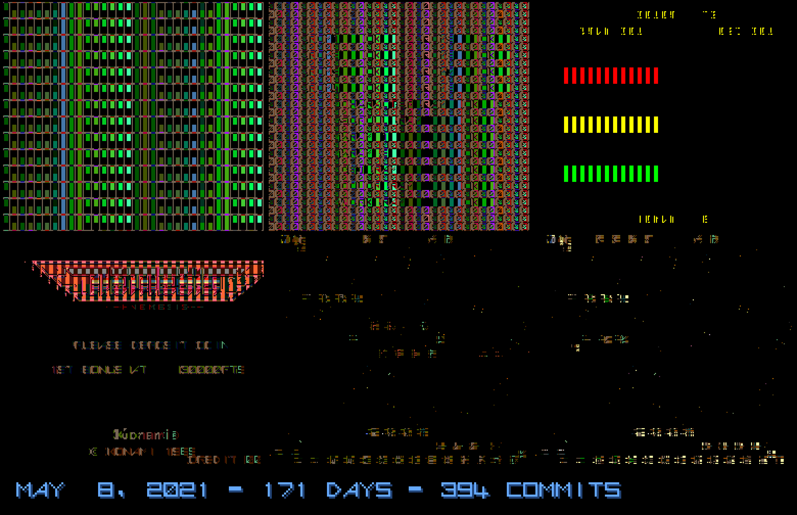

# FPGA Clone of Konami GX400 Arcade System for MiSTer

FPGA compatible core for the Nemesis (1985) arcade hardware for MiSTer FPGA, written by [LMN-san][@LmnSama], [OScherler][@oscherler], and [Raki][@RCAVictorCo]. This core is based on the Nemesis schematics from Konami and has been verified against several different physical PCBs (Konami Bubble System, Salamander, Salamander Bootleg). The game is fully playable and there are no known issues.

Our goal during development was to be as close to the original hardware as possible, and not to rely on superficiality and supposition, which is why, after releasing the first version, we continued improving the reproduction accuracy with more tests and measurements. Great efforts have been made towards accuracy. Raki wrote a custom ROM for the 68000 to test all possible cases of tile/sprite priority bits on original hardware. LmnSan wrote a custom ROM for the Z80 to play test sounds on all channels, at every volume and every frequency, and did a thorough analysis of the results compared to original hardware. OScherler also knows how to write custom ROMs, but the ones he made for this project are less impressive.

This core was developed using the [jtframe][] framework by Jotego ([@topapate][]).

[@LmnSama]:     https://twitter.com/@LmnSama
[@oscherler]:   https://tooting.ch/@oscherler
[@RCAVictorCo]: https://twitter.com/@RCAVictorCo
[jtframe]:      https://github.com/jotego/jtcores
[@topapate]:    https://twitter.com/topapate
[mosaic]:       doc/nemesis-mosaic.gif

## Installation

Install from [JTCORES for MiSTer][jtcores_mister], either via [Update All][], which installs them by default, or manually by following [these instructions][jtcores_instructions].

[jtcores_mister]: https://github.com/jotego/jtcores_mister
[Update All]: https://github.com/theypsilon/Update_All_MiSTer
[jtcores_instructions]: https://github.com/jotego/jtcores_mister#download

## Supported Games

Game         | Status      | Release
-------------|-------------|----------
Nemesis      | Implemented | Stable
Nemesis (UK) | Implemented | Stable

## Custom ICs

There are 8 custom Konami ICs on the Nemesis system. Most of them are used in several games. 

In particular, the overall features of the GFX board were built based on a [Salamander bootleg][PCB]. We drew full schematics to figure out what the function of each IC is, and we made the clone models with the same functionalities by analyzing actual waveform captures from the original chips. In the case of the sprite engine especially, it took a lot of effort because there is a state machine that manages sprite scaling. Since it was pointed out that there was a problem with the sprite scaler of the bootleg, we made [a program][diagnostics] written in 68k assembly that can display a modifiable sprite for inspection. We measured the width and height of the sprite displayed on a Bubble System PCB and compared data with the hardware implementation of the bootleg. In addition, we found that there was a problem with the priority handler section of the MAME driver, `nemesis.cpp`. A problem with the tilemap being messed up occurred in some games originally released on Bubble System that were not currently supported by MAME. To solve the problem, we tried all priority bits, sorted cases, and implemented the original behavior exactly.

[PCB]: https://twitter.com/RCAVictorCo/status/1364872798594686980
[diagnostics]: https://github.com/ika-musume/BubbleDrive8/blob/master/BubbleDrive8_diagnostics/diagnostics_main.X68

Name     | Subsystem | Function
---------|-----------|---------
K005924  | Main      | Watchdog/Coin Operation (not implemented)
K0005289 | Audio     | Pre-SCC Wavetable Sound Generator
K0005290 | GFX       | Tileline Latch
K0005291 | GFX       | Tilemap Generator
K0005292 | GFX       | Video Timing Generator
K0005293 | GFX       | Priority Handler
K0005294 | GFX       | Sprite Latch/MUX
K0005295 | GFX       | Sprite Engine

## External Modules

The core uses the following modules:

Name    | Purpose            | Author         | URL
--------|--------------------|----------------|-----
jtframe | FPGA framework     | Jotego         | https://github.com/jotego/jtcores
jt49    | AY-3-8910 PSG      | Jotego         | https://github.com/jotego/jt49
fx68k   | Motorola 68000 CPU | Jorge Cwik     | https://github.com/ijor/fx68k
T80s    | Zilog Z80 CPU      | Daniel Wallner | Included in jtframe

## Known Issues

None.

Please report issues in [the issue tracker][issues], and mention [@oscherler][oscherler-gh].

[issues]: https://github.com/jotego/jtcores/issues
[oscherler-gh]: https://github.com/oscherler

## Acknowledgements

The authors would like to thank

* Alamone, for the audio tests
* HirofumiIwasaki, for the audio recordings
* atrac17
* Ace
    
and

* Jotego, for the jtframe framework
* Sorgelig, for the MiSTer project
